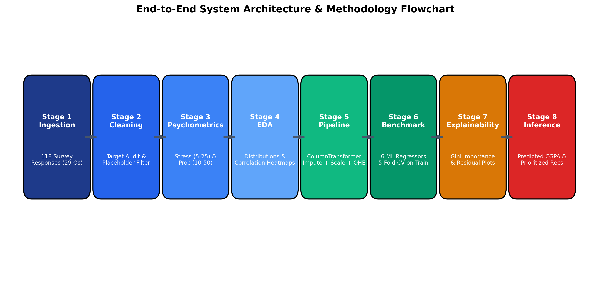
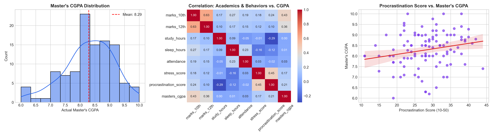
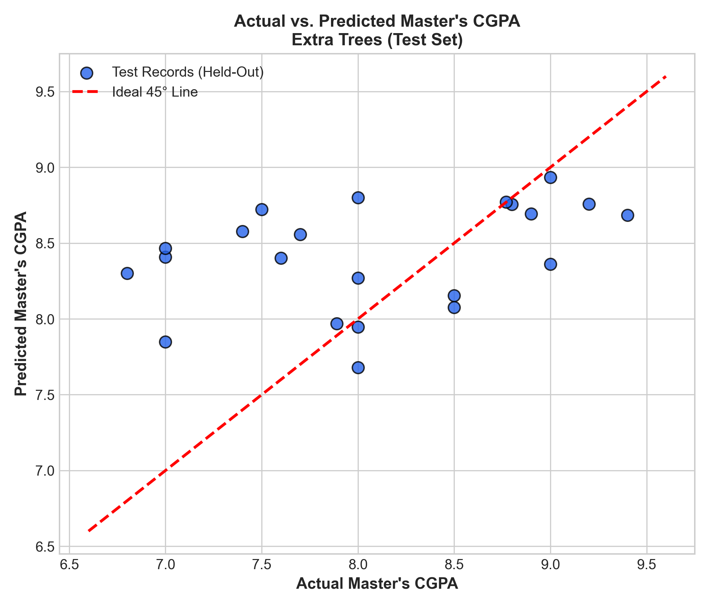
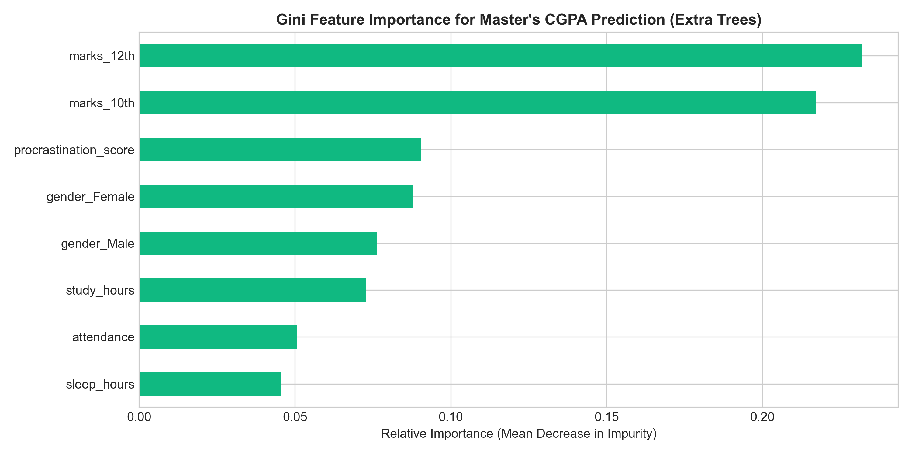

<div align="center">

# 🎓 AI Student Failure Pattern Analyzer
### Analyzing Academic and Behavioral Factors for Early Risk Detection & Performance Prediction

[](https://www.python.org/)
[](https://streamlit.io/)
[](https://scikit-learn.org/)
[](https://github.com/himani2005tuli-wq/AI-Student-Failure-Pattern-Analyzer)
[](LICENSE)

<p align="center">
  <strong>An end-to-end predictive and prescriptive machine learning system combining academic foundation markers, lifestyle habits, and psychometric behavioural indicators to detect academic vulnerability early and recommend personalized recovery interventions.</strong>
</p>

</div>

## 📌 Executive Summary

Predicting student academic failure or underperformance at the post-graduate level requires moving beyond historical exam percentages to integrate **lifestyle routines, time-management self-efficacy, and stress-coping capacity**. 

The **AI Student Failure Pattern Analyzer** provides a robust, scientifically validated framework that:
1. **Audits ground-truth academic targets** to eliminate target contamination and data leakage.
2. **Trains and benchmarks 6 regression algorithms** using 5-fold cross-validation on training data to select an optimal champion model.
3. **Decouples prediction from prescriptive guidance**, delivering prioritized, explained behavioral recommendations.
4. **Enables interactive "What-If" intervention simulations** to assess hypothetical performance trajectories without assuming causal monotonicity.
5. **Supplies institutional advisors with batch audit reporting** to categorize cohorts into actionable advisory risk tiers.

---

## 🏛️ System Architecture

The end-to-end framework bridges survey ingestion, leak-free preprocessing, cross-validated ensemble learning, and multi-tier interactive visualization:

<div align="center">
  
</div>

---

## 🔬 Dataset & Ground-Truth Target Verification

The underlying survey comprises 118 student responses across 29 academic and psychometric survey items collected via Google Forms (`118 records.csv`).

### Target Variable Verification & Cohort Breakdown
In the Indian higher education system, *"Graduation"* designates undergraduate Bachelor's degrees (B.Sc., B.Tech, B.Com, etc.), whereas Master's degrees are termed *"Post-Graduation"*. To prevent target contamination, every respondent's academic outcome was audited:

| Cohort Category | Records | Verification Finding | Treatment in Model Training | Treatment in Batch App |
| :--- | :---: | :--- | :--- | :--- |
| **Semester 1 Cohort** | **9** | First-semester students had not completed university PG examinations and reported undergraduate marks. | **Excluded from Supervised Training** | Retained for inference (Audited: `Excluded: Semester 1 (UG Marks)`) |
| **Zero-Placeholder Records** | **2** | Rows with `0.00` representing unrecorded non-responses. | **Excluded from Supervised Training** | Retained for inference (Audited: `Excluded: Zero-Placeholder`) |
| **Valid Master's CGPA Targets** | **107** | Semesters 2, 3, and 4 respondents with active Master's CGPA. | **Retained for Training & CV** | Benchmark evaluation strictly uses these 107 records |
| **Total Cohort** | **118** | Complete survey responses | **107 Trainable / 11 Excluded** | All 118 processed transparently |

### Valid Target Distribution (N = 107)
* **Scale Bounds:** Min = `6.00` CGPA, Max = `10.00` CGPA
* **Mean Performance:** `8.29` CGPA &nbsp;|&nbsp; **Median:** `8.30` CGPA &nbsp;|&nbsp; **Std Dev:** `0.81` CGPA

---

## 📈 Exploratory Data Analysis & Psychometric Distributions

Composite psychometric scoring was engineered using validated multi-item scales:
* **Perceived Stress Score (PSS):** 5 items (5–25 scale, sample mean = `13.91`, range = `[7, 21]`).
* **Academic Procrastination Score (APS):** 10 items (10–50 scale, sample mean = `28.36`, range = `[11, 44]`).

<div align="center">
  
</div>

---

## 📊 Model Benchmarking & Evaluation

Preprocessing pipelines (`ColumnTransformer` with median imputation + standard scaling for numeric features, and one-hot encoding for categorical variables) were fit strictly on training folds to prevent data snooping. 

Model selection was conducted via **5-fold cross-validation on the 85 training samples**, reserving the 22 held-out test samples (20%) for final validation:

| Rank | Model Pipeline | 5-Fold CV MAE (Train) | 5-Fold CV RMSE (Train) | 5-Fold CV $R^2$ (Train) | Test MAE | Test RMSE | Test $R^2$ | Selection Decision |
| :---: | :--- | :---: | :---: | :---: | :---: | :---: | :---: | :--- |
| 🥇 | **Extra Trees Regressor** | **0.6086** | **0.7772** | **+0.0718** | **0.6223** | **0.7877** | **-0.0436** | **Champion Model** |
| 🥈 | Random Forest Regressor | 0.6173 | 0.7873 | +0.0529 | 0.5676 | 0.7500 | +0.0540 | Runner-Up |
| 🥉 | Gradient Boosting Regressor | 0.6355 | 0.8144 | -0.0217 | 0.5452 | 0.7508 | +0.0519 | Baseline Boosting |
| 4 | Decision Tree Regressor | 0.6437 | 0.8115 | -0.0506 | 0.7467 | 0.8697 | -0.2720 | High Variance |
| 5 | Ridge Regression | 0.6594 | 0.8749 | -0.2324 | 0.6513 | 0.7962 | -0.0661 | Linear Regularized |
| 6 | Linear Regression | 0.7232 | 0.9343 | -0.4620 | 0.6605 | 0.8040 | -0.0873 | Multicollinear Baseline |

> [!NOTE]
> **Academic Model Selection Rationale:**  
> While Random Forest showed slightly lower error on the 22 test samples, selecting an algorithm based on test-set metrics constitutes *test-set snooping*. Extra Trees demonstrated superior generalization across internal validation folds (lowest CV MAE: `0.6086` and highest CV $R^2$: `+0.0718`).

### Evaluation Visualizations

<div align="center">
  <table>
    <tr>
      <td width="50%">
        <h4 align="center">Actual vs. Predicted CGPA</h4>
        
      </td>
      <td width="50%">
        <h4 align="center">Gini Feature Importance Rankings</h4>
        
      </td>
    </tr>
  </table>
</div>

### Top Predictors in Extra Trees
1. **12th Grade Marks:** `23.2%` (Foundational academic capability)
2. **10th Grade Marks:** `21.7%` (Long-term scholastic consistency)
3. **Academic Procrastination Score:** `9.1%` (Primary behavioral inhibitor)
4. **Gender (Categorical One-Hot):** `8.8%` / `7.6%`
5. **Daily Independent Study Hours:** `7.3%` (Direct academic commitment)
6. **Class Attendance Percentage:** `5.1%` (Institutional engagement)
7. **Average Sleep Duration:** `4.5%` (Cognitive recovery)
8. **Perceived Stress Score:** `2.8%` (Emotional strain)

---

## 🎯 Prescriptive Recommendation Engine

To avoid black-box suggestions, the recommendation engine is **fully decoupled** from the regression pipeline and evaluates student habits against documented institutional and cognitive thresholds:

| Factor | Valid Range | Trigger Threshold | Priority | Actionable Prescriptive Guidance | Trigger Explanation Displayed |
| :--- | :---: | :---: | :---: | :--- | :--- |
| **Attendance** | 0.0 – 100% | `< 75.0%` | **High** | Prioritize regular lecture attendance; request lecture recordings/notes for missed classes; coordinate with course mentors. | Monthly attendance falls below the institutional minimum requirement of 75%. |
| **Perceived Stress** | 5.0 – 25.0 | `> 18.0` | **High** | Access university academic counseling or wellness cell resources for structured stress coping strategies *(non-clinical advisory)*. | Perceived stress score is elevated, signaling risk of burnout and cognitive fatigue. |
| **Procrastination** | 10.0 – 50.0 | `> 32.0` | **High** | Deconstruct major term projects into smaller micro-milestones with self-imposed weekly completion targets; apply Pomodoro technique. | Procrastination score indicates recurring assignment delay and avoidance. |
| **Study Hours** | 0.0 – 12.0 hrs | `< 3.0 hrs/day` | **Medium** | Establish a consistent daily timetable allocating 3–4 hours for focused, distraction-free study blocks. | Daily self-study duration is below the recommended post-graduate study load. |
| **Sleep Hours** | 0.0 – 12.0 hrs | `< 6.0 hrs/night` | **Low** | Maintain a regular sleep schedule aiming for 7–8 hours of restful sleep to support memory consolidation and retention. | Average sleep duration is insufficient for optimal cognitive performance. |
| **Healthy Standing** | All Above | Within targets | **Positive** | Maintain your disciplined study habits and current work-life balance; mentor peers in study groups. | All monitored behavioural indicators are within healthy ranges. |

---

## 🔮 What-If Intervention Simulator

The What-If Simulator enables advisors and students to model prospective changes in study habits:
$$\Delta = \text{Hypothetical Predicted CGPA} - \text{Baseline Predicted CGPA}$$

* **Non-Causal Notice:** Clearly informs students that machine learning predictions reflect associative patterns rather than causal guarantees.
* **Bi-directional Feedback:** Accurately visualizes positive ($\Delta > 0$), negative ($\Delta < 0$), or neutral ($\Delta = 0$) impacts.

---

## 🖥️ Streamlit Interactive Application

The web interface (`app.py`) is organized into four interactive modules:

```text
┌─────────────────────────────────────────────────────────────────────────────┐
│ 🎓 AI Student Failure Pattern Analyzer                                      │
├─────────────────────────────────────────────────────────────────────────────┤
│  Tab 1: Single Student Assessment & Recommendations                         │
│    • Real-time CGPA Gauge Chart & Advisory Risk Tier badge                  │
│    • 5-Axis Behavioral Radar Chart (Attendance, Study, Sleep, Stress, Proc) │
│    • Persona Quick-Presets (High-Risk, Stressed Achiever, Consistent)      │
│    • Prioritized, explained intervention action cards                       │
│                                                                             │
│  Tab 2: What-If Intervention Simulator                                     │
│    • Dynamic habit adjustment sliders (Study, Sleep, Attendance, Stress)    │
│    • Side-by-side Baseline vs. Hypothetical CGPA bar chart                  │
│    • Exact numerical delta (Δ) calculation with advisory interpretation     │
│                                                                             │
│  Tab 3: Batch Analysis & Target Audit                                       │
│    • Process full 118-student cohorts with Ground-Truth Target Audit        │
│    • Automatic separation of valid Master's CGPA vs. Semester 1 UG records  │
│    • One-click exportable CSV risk report                                   │
│                                                                             │
│  Tab 4: Model Evaluation & Architecture                                     │
│    • Interactive Plotly benchmark comparison (CV MAE vs. Test MAE)          │
│    • Top-10 Gini Feature Importance horizontal chart                        │
│    • Actual vs. Predicted scatter plot & System Architecture Flowchart      │
└─────────────────────────────────────────────────────────────────────────────┘
```

---

## 📂 Repository File Structure

```text
├── 118 records.csv                  # Official survey dataset (ZIP-compatible format)
├── app.py                           # Full Streamlit interactive dashboard (Tabs 1-4)
├── train_pipeline.py                # End-to-end training, CV & artifact serialization
├── test_suite.py                    # 11-point automated verification & test suite
├── finalcode .ipynb                 # Documented Jupyter Notebook for research defense
├── requirements.txt                 # Exact Python dependency specifications
├── .gitignore                       # Git ignore rules (caches, checkpoints, logs)
├── LICENSE                          # MIT Open-Source License
├── README.md                        # Academic documentation & system guide
├── Project_Synopsis.pdf             # Project research synopsis
├── Project_Final_Report.pdf         # Comprehensive research project report
├── qrcode_docs.google.com.png       # Survey instrument QR code
└── outputs/                         # Serialized production artifacts & plots
    ├── best_pipeline.joblib         # Extra Trees champion model pipeline
    ├── benchmark_metrics.joblib     # Cross-validation & test comparison metrics
    ├── feature_importances.joblib   # Gini feature importance rankings
    ├── training_metadata.joblib     # Hyperparameters, feature schemas & metrics
    └── plots/
        ├── architecture_flowchart.png
        ├── system_eda_overview.png
        ├── actual_vs_predicted.png
        └── feature_importance.png
```

---

## 🚀 Quickstart & Reproducibility Guide

### 1. Clone the Repository
```bash
git clone https://github.com/himani2005tuli-wq/AI-Student-Failure-Pattern-Analyzer.git
cd AI-Student-Failure-Pattern-Analyzer
```

### 2. Set Up Virtual Environment & Install Dependencies
```bash
python -m venv venv
# On Windows:
.\venv\Scripts\activate
# On macOS/Linux:
source venv/bin/activate

pip install -r requirements.txt
```

### 3. Retrain the Machine Learning Pipeline
To execute data ingestion, target verification, 5-fold cross-validation, and artifact generation:
```bash
python train_pipeline.py
```

### 4. Run the Automated 11-Point Verification Suite
To verify model loading, predictions, presets, recommendation logic, and batch processing:
```bash
python test_suite.py
```

### 5. Launch the Streamlit Web Application
```bash
streamlit run app.py
```
Open **[http://localhost:8501](http://localhost:8501)** in your web browser.

---

## 🧪 Automated Verification Suite Results

Running `python test_suite.py` executes 11 rigorous verification assertions:
```text
===========================================================================
COMPREHENSIVE VERIFICATION & TEST SUITE
===========================================================================
[+] Test 1 & 2 PASSED: All 4 production artifacts exist in outputs/ directory.
[+] Champion Model in Metadata: Extra Trees
[+] Top Model in Benchmark Table: Extra Trees (CV MAE: 0.6086)
[+] Test 3 PASSED: Champion model selection is strictly driven by training 5-fold cross-validation.
    - High-Risk Candidate Preset: Raw Pred = 8.419, Clipped = 8.42 / 10.0
    - Average Student with High Stress Preset: Raw Pred = 8.083, Clipped = 8.08 / 10.0
    - High Achiever Preset: Raw Pred = 8.694, Clipped = 8.69 / 10.0
[+] Test 4 & 5 PASSED: Individual predictions execute successfully and adhere to natural scale bounds.
[+] Test 6 PASSED: Recommendation engine triggers, prioritizes, and explains all actions correctly.
    - Positive Scenario Delta: -0.76 CGPA
    - Negative Scenario Delta: +0.04 CGPA
    - Zero Scenario Delta    : +0.00 CGPA
[+] Test 7 PASSED: What-If simulator accurately computes exact mathematical delta.
    - Total records for batch prediction: 118
    - Missing / Zero-placeholder records : 2
    - Semester 1 (wrong outcome) records : 9
    - Total records excluded from eval   : 11
    - Valid Master's CGPA records        : 107
    - Model Training samples             : 85
    - Model Testing samples              : 22
[+] Test 8 & 9 PASSED: Batch analysis cleanly isolates valid Master's CGPA (107) vs excluded records (11).
    - Prediction on missing/unseen input: 8.31 / 10.0
[+] Test 10 & 11 PASSED: Missing values and unknown categorical levels handled without error.

===========================================================================
ALL 11 APPLICATION VERIFICATION CHECKS PASSED WITH ZERO ERRORS!
===========================================================================
```

---

## ⚖️ Ethical & Advisory Disclaimers
1. **Non-Clinical Suggestions:** Stress-related suggestions are educational wellness advisories and must never be interpreted as clinical psychological or medical diagnoses.
2. **Non-Deterministic Interventions:** Behavioral recommendations promote structured study discipline but do not guarantee specific academic grade outcomes.
3. **Advisory Risk Tiers:** Risk categories (High, Medium, Low) are rule-based heuristic guidance indicators to assist academic counselors in prioritizing student outreach.

---

## 📜 Citation & Attribution

If you reference or build upon this project, please cite:

```bibtex
@misc{studentfailurepatternanalyzer2026,
  title = {AI Student Failure Pattern Analyzer: Analyzing Academic and Behavioral Factors for Student Performance Prediction & Early Risk Detection},
  year = {2026},
  url = {https://github.com/himani2005tuli-wq/AI-Student-Failure-Pattern-Analyzer}
}
```

---

<div align="center">
  <sub>AI Student Failure Pattern Analyzer &bull; Open-Source Academic Research System</sub>
</div>
